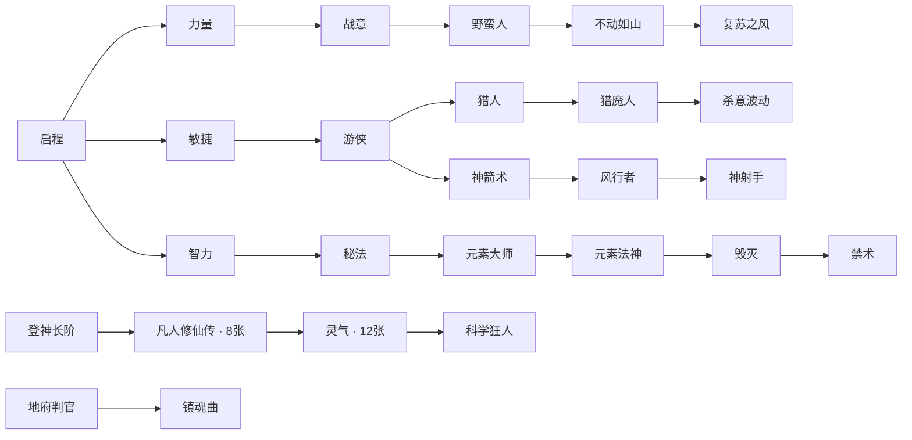

# 独立卡与后半局成长

当前有26个羁绊家族、101张唯一卡、32个技能和12名英雄。卡片只获得一次；集齐真实成员后永久保留组合效果，释放未完成家族槽位，并解锁后继池。开局前三张仍固定为启程。

前置组合和阶段门槛同时生效：第一批后继池在20级或8分钟开放，第二批在40级或15分钟开放，终阶池在50级或20分钟开放。抽取与确认均检查门槛；没有可选卡时不扣费。所有已收集卡片、前置条件和组合效果可在H图鉴中查看；战斗条最多保留六个在建或刚完成的组合。

非UR技能五级训练完成后仍有成长选择：30／40／50级分别开放一阶升华，同时需要完成2／3／4套羁绊或通过塔4／8／12层。UR满级后选择一条专属进化路线，不再进入线性升华，见[UR分路](ur-evolution.md)。吞噬新英雄会扩大技能容量。骷髅合体巨像，回旋刃增加数量及内外轨，水元素巨大化并发出贯穿击退；其他技能增加对应元素派生攻击。满槽时，UR选择明确显示旧技能→新技能，确认后退休旧召唤及残留伤害源；反复换回技能不会重复发放永久训练属性。

新增焚焰射线持续扫射并真实贯穿伤害；地精地雷实际武装、接近引爆、范围伤害及有限数量。虚天鼎由实际受伤触发范围自适应伤害，青竹蜂云剑追加完整武器攻击，系列增伤随实际收集数更新。暴击、吸血、目标与距离增伤、模型体型均接入实际运行值。

原图核实效果和补全适配逐项列在[来源表](bond-pool-expansion.md)及[公开渠道记录](reference-expansion-2026-09-30.md)。公开资料不足以证明完整原图目录；本作扩充不冒称完整复刻。

验收覆盖全101卡真实ECS抽取／刷新／暂存／确认／去重／池耗尽、后继门槛、满槽升华和替换、防重复属性、实际伤害与吸血、暂停和旧技能清理。桌面与紧凑视口的实机证据汇总在[验收记录](../screenshots/expansion-validation.txt)。
