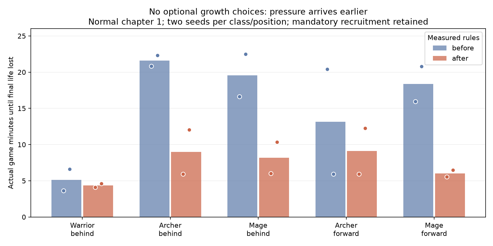

# 普攻、技能节奏与小怪成长

这轮调整让早期战斗围绕普攻展开：主动伤害技能先积累真实攻击轮次，再等待冷却完成。升级后攻击更快、蓄力要求更低、冷却缩短，较大的技能特效因此成为成长反馈。

## 战斗规则

- 初始攻速为 `2.1 + 0.028 × 敏捷` 次／秒；原值为 `1.45 + 0.028 × 敏捷`。每击伤害和升级的敏捷系数不变。
- 主动伤害技能一级按 R／SR／SSR／UR 分别需要 4／5／6／8 次实际普攻轮次。升级最多减少 2 次；一轮多重射击、弹射或继承武器只贡献一次蓄力。
- 主动伤害技能的冷却按一级到五级乘以 `1.70 / 1.50 / 1.30 / 1.15 / 1.00`。个人冷却与普攻蓄力必须同时满足；详细选牌模式显示实际冷却和蓄力要求。
- 不同伤害技能之间保留 0.2 秒游戏时间间隔。新学技能不继承此前积攒的攻击次数，也不会全部立即爆发。高倍速按实际游戏时间补偿间隔，不因每帧硬上限而削弱技能。
- 首次终结技等待所选英雄的完整冷却；依然自动施放。召唤补充、持续光环、被动和受击触发保留各自触发条件。
- 城墙重建仍无限、倒塌倒计时仍为 4 秒，但已经穿过城墙的敌人不会被重建瞬移回外侧，会继续威胁英雄的三条生命。

## 小怪压力曲线

既有波次的数量、基础生命、伤害和奖励表保留。额外压力从第4波开始，成长步数为 `min(max(波数 − 3, 0), 22)`：生命乘以 `1 + 0.12 × 步数`，移速乘以 `1 + 0.03 × 步数`，攻击频率乘以 `1 + 0.05 × 步数`；各自上限为 `3.7 / 1.8 / 2.2`。连续接触伤害与攻击动作按同一频率倍率结算，避免只加快动作而不增加真实压力。

| 波次 | 额外生命倍率 | 额外移速倍率 | 额外攻击频率倍率 |
| --- | --- | --- | --- |
| 1–3 | 1.00 | 1.00 | 1.00 |
| 5 | 1.24 | 1.06 | 1.10 |
| 10 | 1.84 | 1.21 | 1.35 |
| 15 | 2.44 | 1.36 | 1.60 |
| 20 | 3.04 | 1.51 | 1.85 |
| 25 | 3.64 | 1.66 | 2.10 |

生命倍率在每只小怪入场时按所属波次结算一次，延迟队列保留该波的倍率；已有敌人不会每帧重新乘生命。路上敌人的移速和攻击压力随当前波次提高，防止上一波残留敌人成为无害拖延。主线首领、独立奇遇首领与野怪营地不套用这组普通小怪倍率。

## 测试口径

`balance_sim` 加载完整生产 `GamePlugin`，仅关闭渲染、窗口事件和音频输出；固定 60Hz，使用真实击杀经济、选卡、黑市、英雄升级、吞噬、城墙和怪物系统。受击停顿保留生产系统的虚拟时间缩放，所以曲线使用实际游戏时间。每局使用独立新存档，测试普通难度第一章。基线为提交 `492ebaa` 的生产规则，只补只读普攻观测接口。

`passive` 只完成开局及系统强制的 10／20／40 级英雄选择，不购买可选技能、羁绊或装备。强制换英雄仍会继承能力，所以这个策略不是永久只有一级英雄。`active` 点击实际可选的第一张卡，持续消耗免费点、金币和木材，按真实价格购买黑市装备；它是可复现的贪心策略，不能代表最优真人玩法。

三种初始职业分别测试城墙后站位；射手和法师另测前方站位。角色保持固定策略，不主动走位、挑战支线或启动金币试炼／爬塔。帧数上限包括暂停的选牌帧，所有时间比较使用实际游戏时间；未结束的局记录为截尾，不能计成通关。

每 30 秒记录波数、等级、生命、击杀、城墙破坏、实际普攻轮次、主动伤害技能施放次数和敌人峰值。旧基线没有技能施放计数，保留为空，不能据此宣称旧版技能次数减少了某个百分比。新批次强制检查计数存在，并记录二进制 SHA256，防止旧构建混入新结果。

## 已完成的整局结果

两种种子、五种初始职业／站位组合，各比较两种策略；修改前后共 40 局全部实际结束，没有把帧数上限计成通关。

| 初始职业／站位 | 不选可选成长：修改前平均存活 | 修改后平均存活 | 持续选卡：修改后通关 |
| --- | --- | --- | --- |
| 战士／城墙后 | 5分07秒 | 4分21秒 | 2／2 |
| 射手／城墙后 | 21分35秒 | 9分00秒 | 2／2 |
| 法师／城墙后 | 19分33秒 | 8分11秒 | 2／2 |
| 射手／前方 | 13分09秒 | 9分06秒 | 2／2 |
| 法师／前方 | 18分23秒 | 6分01秒 | 2／2 |

修改后不选成长的 10 局全部在第 5–13 波耗尽生命，持续选卡的 10 局全部通过 25 波、没有掉命。前后两个版本的持续选卡策略都能通关；这轮主要缩短无构筑时的安全期，不把第一章调成要求最优操作才能过的难度。种子及强制换英雄会改变能力组合，单个种子的存活时间并非必然随生命倍率单调下降。



[逐局结果](balance/2026-10-06/analysis/cases.csv)、[30秒曲线](balance/2026-10-06/analysis/curves-30s.csv)和[完整原始记录与来源](balance/2026-10-06/provenance.json)随改动归档。数值只代表第一章普通难度、这些种子与固定策略，不外推全章节胜率。

0.08／0.10／0.12 三档生命成长的真实对照中，较弱两档的不选成长射手到约 14 分钟上限仍存活；0.12 档在约 6 分钟失败，而持续选卡到约 14 分钟仍健康。[这四局探测记录](balance/2026-10-06/probe-analysis/cases.csv)包含三次截尾，它们不是通关证据；选择较强档后再完成上面的整局验证。

归档的 40 局使用生产默认并行调度。重复主动构筑时，28个共同采样点中有一个出现一帧受击停顿差异，其余一致；因此它们用于实际胜败及游戏时间比较，不声称每个中间字段逐位确定。后续模拟工具固定单线程调度来复核重放，继续执行同一套生产战斗系统。最终二进制直接使用烘定的默认参数，两次独立存档各运行 50,000 帧（815.769 秒游戏时间），29 个采样点全部一致；这两局为第14波截尾，不计作通关。见[重放校验](balance/2026-10-06/repeat-check.json)。

## 复现

```sh
CARGO_INCREMENTAL=0 nix develop --command cargo build --bin balance_sim -j1
python3 tools/run_balance_matrix.py --binary target/debug/balance_sim \
  --batch balance-check --frames 100000 --seeds A11CE,BEEF \
  --starters 0,1,2 --positions behind --policies passive,active --require-telemetry
python3 tools/analyze_balance.py target/verification/balance-check \
  --output target/verification/balance-check-analysis
```

模拟器还接受六项真实压力资源的覆盖值，顺序为移速成长、攻击频率成长、移速上限、攻击频率上限、生命成长、生命上限；通过 runner 的 `--pressure` 传入，不改写另一套伤害模型。原生 `balance-cadence` 场景验证低级与升级后的实际伤害、普攻／施放频率、首次终结技等待和暂停冻结；`gate-revival` 验证重建不传送敌人及最后一条生命耗尽后失败。

## 构建与原生验收

544 项库测试通过，0 失败、1 项既有测试忽略；三个原生二进制构建、格式检查、所有目标的严格 Clippy 检查通过。桌面 1280×720 与窄屏 667×375 的受控战斗场景各运行 600 帧：前三个伤害技能一级阶段实际施放 4 次、普攻 18 轮；真实英雄等级提升到40、技能升到五级后，施放 7 次、普攻 41 轮。敌人为受控高生命测试靶，不代表整局输出排名。暂停期间计数冻结、首次终结技等待、实际伤害与技能间隔均通过断言。

城墙场景另运行 400 帧，验证跨过倒塌开口的敌人留在英雄侧、重建不传送敌人、实际英雄受伤、4／3／2／1 倒计时、两次复活与第三条生命耗尽后失败。以上原生场景共 1,600 帧，未声称手机真机性能或全章节平衡。

[完整验收记录](balance/2026-10-06/validation.txt) · [低级阶段截图](balance/2026-10-06/balance-final-desktop-frame00029.png) · [升级后截图](balance/2026-10-06/balance-final-desktop-frame00449.png) · [窄屏截图](balance/2026-10-06/balance-final-mobile-frame00449.png) · [城墙重建后截图](balance/2026-10-06/balance-final-gate-frame00069.png)
