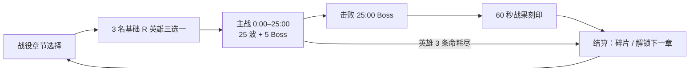

# Rogue Commander 游戏策划案（按当前实现整理）

> 整理日期：2026-10-02 · 基线：`main` 工作区（含未提交改动）
> 口径：**以代码为准**。文中数值均取自 `src/game/`，与旧文档冲突处在末节“异常与风险清单”列出。
> 本文是总览与索引；单项系统的细节、来源考据和验收记录见各专题文档（文中链接）。原作考据与“公开确认/首版设计/未知可调”标记见 [gameplay-spec.md](gameplay-spec.md)。

---

## 1. 核心定位

| 项 | 内容 |
|---|---|
| 类型 | 横向守门 + 自动战斗 + 局内构筑的 roguelike 生存塔防（单机） |
| 参照 | 玩法节奏复刻《刀塔指挥家》（25 分钟防守、技能/羁绊双抽、爬塔、金币挑战、黑市）；角色、名称、美术、数值为原创或适配 |
| 平台 | 桌面（Bevy 0.19 原生）与 Web（wasm，GitHub Pages），手机横屏可玩 |
| 语言 | English / 简体中文，运行中即时切换（默认英文） |
| 单局时长 | 主战 25:00 + 最终 Boss 战 + 60 秒“战果刻印” |
| 玩家操作 | 只控制英雄移动与闪避；普攻、技能、终结技全部自动；在抽卡面板中做构筑决策 |
| 核心乐趣 | 三种资源分别驱动三条构筑线（金币→技能、木材→羁绊、杀敌→黑市），在 Q/W 挑战和主线防守之间分配输出 |

## 2. 一局流程

### 2.1 时间线

| 时间 | 事件 | 代码 |
|---|---|---|
| 0:00 | 选英雄（暂停中）；初始金币 10、木材 60、城门 1,000 耐久、刷新 1 次 | `resources.rs` `GameSession::default` |
| 0:04 | 首次免费技能抽取（G） | `progression.rs` `FIRST_FREE_SKILL_AT` |
| 0:12 | 首次免费羁绊抽取（F，固定为“启程”） | `FIRST_FREE_BOND_AT` |
| 0:18 | 爬塔 Q 解锁（24 层同一解锁时间） | `trial.rs` `TOWER_UNLOCK_AT` |
| 1:00 | 金币挑战 W 解锁 | `GOLD_UNLOCK_AT` |
| 2:00 起每 120 秒 | 常规刷怪中插入 1 只精英 | `combat.rs` `next_elite_at += 120` |
| 3:00 | 黑市开放（Lv1） | `market.rs` `MARKET_UNLOCK_AT` |
| 5/10/15/20/25:00 | 检查点 Boss；击败前 4 个后黑市依次升至 Lv2–Lv5 | `combat.rs` `BOSS_TIMES`、`market_level` |
| 8:00 | 第一批后继羁绊池开放（或 20 级） | `bond_stage_requirement` |
| 12:00 | UR 技能进入技能池；满槽时可出现“替换为 UR” | `EPIC_SKILL_UNLOCK_AT` |
| 15:00 | 第二批后继羁绊池（或 40 级） | 同上 |
| 20:00 | 终阶羁绊池（或 50 级） | 同上 |
| 25:00 | 最终 Boss 翠绿摄政；入场 90 秒后每 10 秒狂暴 +25% 伤害 / +6% 移速 | `bosses.rs` |
| 击败后 | 停止常规出怪，进入 60 秒战果刻印（目标 600,000 HP） | `archive.rs` |

等级里程碑：5/10/15/20/25 级各送 1 次免费技能抽取；10/20/40 级各触发 1 次英雄招募。

### 2.2 胜负

- **失败**：英雄 3 条命全部耗尽（复活等待 8 秒、11 秒；第三次死亡立即失败）。免死技能/道具先结算。
- **城门**：1,000 耐久，横跨道路阻挡敌人；耐久归零后隐藏、4 秒倒计时满血重建，次数不限，**城门倒下不判负**。
- **胜利**：击败 25:00 Boss 后进入战果刻印；击破刻印或撑满 60 秒都判胜利。

## 3. 战场与战斗基础

| 参数 | 值 |
|---|---|
| 方向 | 敌人从右（x≈15.3–16.4）向左推进，城门 x=-5.2，英雄出生/复活 x=-8.2 |
| 英雄活动范围 | x∈[-10,10]，z∈[-12,12]；上下营地经侧门小径连接主路 |
| 闪避 | 冷却 4.5 秒，位移 3.2 米，无敌 0.22 秒；复活无敌 1.2 秒 |
| 属性公式 | 生命 = 基础 + 力量×14；能量 = 基础 + 智力×8；攻击 = 武器 + 主属性；法强 = 20 + 智力×2；召唤强度 = 法强×0.7 + 攻击×0.5 |
| 护甲 | 物理承伤 = 100 / (100 + 5×护甲) |
| 控制衰减 | 精英 ×0.5，Boss ×0.2；Boss 免疫强制位移 |
| 普通敌人同屏上限 | 130；超限 8 秒后把积压合并为一只等总量强化怪，不丢压力 |
| 召唤物硬上限 | 20（共享） |
| 战斗速度 | 1×/2×/4×/8×/16×/32×（T 键或 HUD 按钮） |

公式与对象池细节见 [gameplay-spec.md §2、§14](gameplay-spec.md)。

## 4. 英雄与招募

### 4.1 英雄名册（12 名，R/SR/SSR/UR 各 3，每档力/敏/智各 1）

| 英雄 | 品阶 | 主属性 | 初始 力/敏/智；每级成长 | 基础生命/能量 | 起手技能池（三选一，随种子） | 被动 | 终结技（CD 秒） |
|---|---|---|---|---|---|---|---|
| 玄霆术师 | R | 智 | 20/18/28；2.0/2.0/3.4 | 520/280 | 紫电链、感电印、雷霆万钧 | 余响算式 | 雷域 50 |
| 烬弦猎手 | R | 敏 | 18/30/18；2.0/3.5/1.8 | 500/210 | 火焰箭、焚身环、陨星种 | 追猎节拍 | 赤羽齐射 45 |
| 山铠守卫 | R | 力 | 32/16/16；3.8/1.7/1.6 | 680/190 | 裂地劲、处决印、守誓旗 | 守门山势 | 山岳锚定 50 |
| 潮界行者 | SR | 智 | 24/22/25；2.5/2.4/2.8 | 590/270 | 大海无量、寒冰箭、龙卷风 | 潮霜交界 | 静海 52 |
| 星筹浪客 | SR | 敏 | 20/28/22；2.0/3.1/2.4 | 520/240 | 秘能飞星、炼金火花、命运立方 | 有利筹码 | 满载命运 48 |
| 森垒机巧师 | SR | 力 | 29/17/23；3.2/1.8/2.7 | 610/250 | 雷弩塔、操纵死尸、守誓旗 | 活木修缮 | 城垒超载 58 |
| 霜脉先知 | SSR | 智 | 19/17/31；1.9/1.8/3.6 | 500/310 | 寒冰箭、冰锥天降、冰霜骨龙 | 冰镜预言 | 绝对零度 54 |
| 铁血狂战 | SSR | 力 | 31/23/15；3.5/2.5/1.5 | 640/180 | 处决印、血轮、余烬返生 | 铁血续战 | 钢铁狂袭 48 |
| 裂隙舞者 | SSR | 敏 | 21/31/20；2.1/3.4/2.0 | 530/215 | 回旋风刃、御剑阵、棱镜回响 | 相位步 | 相位剑暴 46 |
| 灵契牧者 | UR | 智 | 22/18/29；2.3/1.8/3.2 | 550/300 | 操纵死尸、灵猎群、水元素 | 契群 | 万灵行军 55 |
| 曜光先锋 | UR | 力 | 30/20/22；3.3/2.0/2.5 | 620/245 | 裂地劲、天穹裁决、陨星种 | 黎明誓约 | 曙光壁垒 52 |
| 虚空收割者 | UR | 敏 | 22/29/23；2.2/3.2/2.5 | 550/245 | 箭术、秘能飞星、三仪轮 | 虚相回声 | 事件视界 50 |

来源：`content.rs` `HEROES`。终结技全部自动施放、HUD 无入口，各自表现见 [automatic-ultimates.md](automatic-ultimates.md)；普攻表现见 [weapon-presentation.md](weapon-presentation.md)。

### 4.2 品阶倍率（`content.rs` `Rarity`）

| 品阶 | 抽取权重 | 英雄属性 | 英雄能力威力/冷却 | 起手技能等级 | 技能威力/冷却 |
|---|---:|---:|---:|---:|---:|
| R | 52 | ×1.00 | ×1.00 / ×1.00 | 1 | ×1.00 / ×1.00 |
| SR | 28 | ×1.12 | ×1.18 / ×0.92 | 2 | ×1.18 / ×0.95 |
| SSR | 15 | ×1.28 | ×1.45 / ×0.82 | 3 | ×1.45 / ×0.88 |
| UR | 5 | ×1.50 | ×1.85 / ×0.70 | 4 | ×1.85 / ×0.78 |

### 4.3 招募与吞噬

- **开局**：只提供 3 名 R 英雄（力/敏/智各一）。
- **招募时机**：10、20、40 级各 1 次；“战意 / 秘法 / 神箭术”首次集齐各奖励 1 枚转职果实，可在 HUD 主动使用。点击卡牌选择时才扣名额/果实。
- **候选**：从其余 11 名英雄中按品阶权重不放回抽 6 名（排除当前英雄），起手技能从该英雄的三选一池中按种子决定。
- **吞噬**：旧英雄当前等级的原生三围叠加到新英雄；旧武器每 4 次普攻以 45% 攻击回响一次，旧被动与终结技继续生效；技能等级、升华、装备、羁绊全部保留；缺失生命/能量保留。
- **技能槽**：每招募一名**新**英雄，技能容量 +1（6 → 最多 9）；新英雄起手技能按其品阶等级加入构筑。
- 等级上限 60，升级经验 = `60 + 18 × (当前等级 − 1)`。

细节见 [hero-fusion.md](hero-fusion.md)、[career-and-auto-trials.md](career-and-auto-trials.md)。

## 5. 技能系统（G）

### 5.1 技能目录（32 个，`content.rs` `SKILLS`）

| 品阶 | 数量 | 技能 | 进池条件 |
|---|---:|---|---|
| R | 12 | 紫电链、火焰箭、寒冰箭、大海无量、操纵死尸、灵猎群、回旋风刃、箭术、秘能飞星、裂地劲、感电印、焚身环 | 始终 |
| SR | 10 | 雷霆万钧、陨星种、冰锥天降、龙卷风、水元素、雷弩塔、处决印、御剑阵、焚焰射线、地精地雷 | 等级 ≥ 3 |
| SSR | 6 | 棱镜回响、守誓旗、炼金火花、血轮、天穹裁决、余烬返生 | 等级 ≥ 8 |
| UR | 4 | 冰霜骨龙、先祖巨像、三仪轮、命运立方 | 时间 ≥ 12:00，每手最多 1 张 |

所有技能最高 5 级（登临之冠可让最高级技能临时到 6 级）。数值公式见 [gameplay-spec.md §6](gameplay-spec.md)，选牌详情页规则见 [skill-selection-details.md](skill-selection-details.md)。

### 5.2 抽取规则

- **价格**：`80 + 15n + 20 × max(n−2, 0)²`（n=已付费次数） 金币；免费次数（0:04 一次 + 5/10/15/20/25 级各一次）优先消耗。
- **候选**：三选一。所有位置按品阶权重随机抽取，不保送最高等级技能；满级技能移出池；技能槽满后只出现已学技能。
- **偏好保底**：若上一手没有匹配英雄标签或已学技能标签的候选，本手替换一张为匹配候选。
- **刷新/放弃/稍后**：刷新消耗共享刷新次数（初始 1）；放弃本手返还 1 次刷新；稍后选择保留付款，下次打开不再扣费。
- **抽卡面板打开时暂停战斗**（手机可读性改编，原作不停表）。

### 5.3 满级后的成长

| 路线 | 条件 | 效果 |
|---|---|---|
| 非 UR 三阶升华 | 技能 5 级，且等级 30/40/50 **并** 完成 2/3/4 套羁绊（含启程）或爬塔 4/8/12 层 | 每阶增加该技能的元素派生攻击；与普通候选混合随机抽取，不按技能编号保送 |
| UR 专属进化 | UR 技能 5 级 | 下一次 G 抽取给出 3 条路线三选一，本局固定；见 [ur-evolution.md](ur-evolution.md) |
| 满槽替换 UR | 12:00 后、技能槽已满、存在未学 UR | G 抽取中出现“旧技能 → 新 UR”替换项，普通成长尚可用时每手5%概率且不与其他UR同手，旧召唤物与残留伤害源退役 |

升级反馈与召唤体型成长见 [skill-upgrade-feedback.md](skill-upgrade-feedback.md)、[skill-spectacle.md](skill-spectacle.md)。

## 6. 羁绊系统（F）

### 6.1 规则

- 抽的是**独立卡**：每张只能获得一次；集齐家族全部成员 = 完成，效果永久保留，并释放家族槽、开放后继家族。
- **7 个家族槽**只限制“已开始未完成”的家族；第 8 个新家族需要先选择替换一个未完成家族（移除其卡与持续加成，一次性资源不回滚）。
- **开局固定启程**：前三张必定是力量/敏捷/智力启程（3→2→1 张候选），各给对应属性 +20、木材 +20；集齐再给金币 +100、木材 +100，才开放其他家族。
- **候选**：只出现未拥有、前置已完成、阶段门槛已达到的卡，同手不重复。完成任一属性家族前，按“已开始家族 45 / 偏好家族 35 / 其他 20”分桶；完成后直接按卡品阶权重抽，且“敏捷→游侠/神箭术”“力量→战意”“智力→秘法”权重 ×2。
- **羁绊罗盘**（黑市）：下一手保底出现进度最高的未完成家族成员。
- **价格**：`10 + 5 × 付费次数` 木材，不封顶；池空时不开面板、不扣费。整局约可抽 22–28 次，追套型玩家平均完成 4–7 个家族（`cargo test --lib bond_draw_sim -- --ignored --nocapture`）。
- 部分家族有 2/4/6… 张的阶段奖励（如游侠 2/4、凡人修仙传 2/4/6/8、灵气 4/8/12），未集齐时即可生效。

### 6.2 家族与前置（26 家族 / 101 卡，`bond_catalog.rs` + `bond_catalog/expanded.rs`）

| 家族 | 卡数 | 品阶构成 | 前置家族 | 阶段门槛 |
|---|---:|---|---|---|
| 启程 | 3 | R×3 | — | — |
| 我要玩力量 / 我要玩敏捷 / 我要玩智力 | 2 / 2 / 2 | 各 R1 SSR1 | 启程 | — |
| 地府判官 | 2 | SR1 SSR1 | —（启程后） | — |
| 登神长阶 | 5 | R×5 | —（启程后） | — |
| 战意 | 3 | R2 SR1 | 我要玩力量 | — |
| 游侠 | 4 | R3 SR1 | 我要玩敏捷 | — |
| 秘法 | 3 | R1 SR2 | 我要玩智力 | — |
| 神箭术 | 4 | R3 SR1 | 游侠 | — |
| 野蛮人 | 4 | R2 SR2 | 战意 | 8:00 或 20 级 |
| 猎人 | 3 | R1 SR1 SSR1 | 游侠 | 8:00 或 20 级 |
| 风行者 | 4 | R1 SR3 | 神箭术 | 8:00 或 20 级 |
| 元素大师 | 4 | SR×4 | 秘法 | 8:00 或 20 级 |
| 凡人修仙传 | 8 | R1 SR5 SSR2 | 登神长阶 | 8:00 或 20 级 |
| 镇魂曲 | 4 | SR3 SSR1 | 地府判官 | 8:00 或 20 级 |
| 不动如山 | 3 | R1 SR2 | 野蛮人 | 15:00 或 40 级 |
| 猎魔人 | 4 | R2 SR2 | 猎人 | 15:00 或 40 级 |
| 神射手 | 4 | SSR×4 | 风行者 | 15:00 或 40 级 |
| 元素法神 | 4 | SSR×4 | 元素大师 | 15:00 或 40 级 |
| 灵气 | 12 | SR×12 | 凡人修仙传 | 15:00 或 40 级 |
| 复苏之风 | 3 | R1 SR1 SSR1 | 不动如山 | 20:00 或 50 级 |
| 杀意波动 | 4 | R1 SR3 | 猎魔人 | 20:00 或 50 级 |
| 毁灭 | 4 | R1 SSR3 | 元素法神 | 20:00 或 50 级 |
| 禁术 | 2 | SSR×2 | 毁灭 | 20:00 或 50 级 |
| 科学狂人 | 4 | R2 SR1 SSR1 | 灵气 | 20:00 或 50 级 |

全目录品阶：R 33 / SR 45 / SSR 23 / **UR 0**。单卡效果、来源核实与适配说明见 [bond-pool-expansion.md](bond-pool-expansion.md)、[build-expansion.md](build-expansion.md)、[opening-bonds.md](opening-bonds.md)；完成反馈见 [bond-completion-feedback.md](bond-completion-feedback.md)；H 键打开图鉴。

## 7. 经济

### 7.1 三资源闭环

| 资源 | 来源 | 用途 |
|---|---|---|
| 金币 | 被动 2/秒；击杀（敌人表 1–9）；Boss 250/430/610/790/970；W 金币挑战；部分技能/英雄效果 | G 技能抽取 |
| 木材 | Q 爬塔；启程卡与组合；精英 +16；Boss 30/48/66/84/102；星筹浪客被动、命运立方进化等 | F 羁绊抽取 |
| 可用杀敌 | 击杀（多数 1，岩背巨像/攻城投手 5，精英 ×8）；Boss 120/200/280/360/440 | 黑市购买与刷新 |

累计击杀 `total_kills` 单独记录，只用于结算与战役碎片。章节奖励倍率只放大金币和经验，不放大木材和杀敌。

### 7.2 价格公式汇总

| 项 | 公式 / 值 |
|---|---|
| 技能抽取 | `80 + 15n + 20 × max(n−2, 0)²` 金币，n=已付费次数，不封顶 |
| 羁绊抽取 | `10 + 5n` 木材（不封顶） |
| 黑市手动刷新 | 60 / 80 / 100 / 120 杀敌（之后 120），荒市徽章 −20% |
| 黑市商品 | 120–520 杀敌（见 §9） |
| 战役强化 | 每项每级 `15 + 10L + 5L²` 碎片，L=当前级，上限 10 级 |

### 7.3 理论产出估算（第 1 章，按代码表计算，未扣除战斗失败）

| 项 | 估算值 | 说明 |
|---|---:|---|
| 25 波常规敌人 | 1,650 只 | `waves.rs` 测试断言 |
| 常规击杀金币 | ≈ 6,000 | 按每波配比加权 |
| 被动金币 | 3,000 | 2/秒 × 1,500 秒 |
| W 金币挑战 15 级全通 | 54,690 | Σ(100 + ⌊530L/14⌋)×10 |
| 30 次技能抽取总价 | ≈ 6,600 | 25 次付费 ≈ 5,330 |
| Q 爬塔 1–14 层木材 | 1,115 | 24 层全通 2,540 |
| 98 张非启程羁绊总价 | 1,900 | 全部封顶后每张 20 |
| 常规敌人经验 | ≈ 13,600 | 不含塔层“洞察”加成；约 37 级 |

## 8. 挑战（Q 爬塔 / W 金币）

| 项 | Q 爬塔 | W 金币挑战 |
|---|---|---|
| 解锁 | 0:18 | 1:00 |
| 层/级 | 24 层，顺序推进 | 15 级 |
| 目标 | 1 只塔怪，从右上出生，先打城门 | 10 只“藏宝影”，从右下出生，只打英雄 |
| 时限 | 25 秒 | 20 秒 |
| 冷却 | 结束后 8 秒 | 开始即计 60 秒（start-to-start） |
| 生命 | 固定表 1,200 → 3,800,000 | `1,200 × 1.55^(L−1)`（10 只合计） |
| 奖励 | 木材 50 → 150；每层再得 1 点指挥成长（攻击 ×1.08 / 生命 ×1.10 / 经验 +10% 轮转） | 最后一只死亡时一次性发 `(100 + ⌊530(L−1)/14⌋) × 10` 金币 |
| 失败 | 超时重试当前层 | 超时不结算，冷却后重试 |
| 自动 | 按钮旁独立 AUTO 开关，解锁且冷却结束即开 | 同左 |
| F4 | 清除场上全部 Q/W 挑战怪、放弃未结算奖励、关闭两个 AUTO | 同左 |

Q/W 可并行，主战场继续运行。完整层表见 [gameplay-spec.md §11–12](gameplay-spec.md)。

## 9. 黑市与装备（B / I）

- 3:00 开放，固定 5 格（前两格偏永久装备、第 3 格消耗品、后两格混合），每 180 秒自动换货；购买后该格立即补货。可标记商品，杀敌足够时自动购买。
- 等级 = 已击败检查点 Boss 数 + 1（上限 5）。品质概率：

| 品质（显示为） | Lv1 | Lv2 | Lv3 | Lv4 | Lv5 |
|---|---:|---:|---:|---:|---:|
| 白（R） | 80% | 50% | 40% | 20% | 10% |
| 蓝（SR） | 15% | 30% | 25% | 30% | 25% |
| 紫（SSR） | 5% | 10% | 20% | 25% | 30% |
| 橙（SSR） | 0% | 7% | 9% | 15% | 20% |
| 红（UR） | 0% | 3% | 6% | 10% | 15% |

- 商品：5 种消耗品（核心补片 120、技能调谐器 140、羁绊罗盘 180、缓时沙 200、复苏种 180）+ 19 件永久装备（白 5、蓝 4、紫 4、橙 3、红 3，价格 160–520）。效果表见 [gameplay-spec.md §13](gameplay-spec.md)。
- **装备栏（I）**：查看已拥有装备，无槽位上限、无卸下；吞噬英雄后保留。
- **合成（I → Recipes）**：6 个配方，消耗原料、保留原料效果并追加一次额外加成，每局每配方一次。见 [equipment-inventory.md](equipment-inventory.md)。

## 10. 敌人、精英与 Boss

### 10.1 普通敌人（`content.rs` `ENEMIES`，第 1 波基础值，再乘波次倍率）

| 敌人 | HP | 伤害 | 护甲 | 金币/经验/杀敌/破门 | 行为 |
|---|---:|---:|---:|---|---|
| 荒潮工兵 | 55 | 8 | 0 | 2/4/1/8 | 标准近战 |
| 噬群幼兽 | 28 | 5 | 0 | 1/2/1/4 | 高速成群 |
| 甲壳卫 | 150 | 12 | 8 | 4/7/1/14 | 正面减伤 |
| 酸羽射手 | 70 | 9 | 1 | 3/5/1/9 | 优先射击英雄（6 米） |
| 冲城兽 | 80 | 0 | 0 | 3/4/1/20 | 无视英雄直冲城门 |
| 鼓噪祭者 | 95 | 7 | 2 | 4/7/1/10 | 周围敌人加速 |
| 岩背巨像 | 320 | 26 | 12 | 9/14/5/24 | 慢速，免疫击退 |
| 遁地刺客 | 90 | 16 | 2 | 4/7/1/12 | 潜地接近后现身眩晕英雄 1 秒 |
| 血巢医师 | 110 | 5 | 2 | 5/8/1/10 | 治疗邻近敌人 |
| 裂生孢体 | 140 | 10 | 1 | 4/7/1/12 | 死亡分裂 3 只无奖励小体 |
| 沉默眼 | 120 | 9 | 3 | 6/9/1/14 | 邻敌魔抗 +，附近英雄冷却变慢 |
| 攻城投手 | 200 | 18 | 6 | 8/12/5/28 | 远程蓄力轰城门 |

### 10.2 波次

25 波共 1,650 只，单波 18 → 128 只；生命倍率 1.00 → 33.56，伤害倍率 1.00 → 10.00；Boss 波（5/10/15/20/25）数量回落。前两波均匀生成；第三波起约 40% 为巡逻怪，余下在每分钟第 20、44 秒集中出现，两次冲击各有 3 秒魔窟预警。第四波起每次冲击领头怪必为精英，其他怪额外精英概率从 2.5% 增至最高 9%。不增加常规总预算，资源池拥挤时保留待生成队列；完整配比见 `waves.rs`。

### 10.3 精英

保留每 120 秒（2:00 起）的精英晋升，并加入集中冲击领头怪和随波增长的额外精英概率。精英生命 ×6、伤害 ×1.8、体型 ×1.25、金币/经验/杀敌 ×8、额外木材 16，随机一个词缀：

| 词缀 | 效果 |
|---|---|
| 狂乱 | 行动速度 +35% |
| 硬壳 | 护甲 +6；每 8 秒获得 25% 最大生命护盾 |
| 爆裂 | 死亡前 1 秒预警，3.75 米爆炸（2.5 倍伤害） |
| 血祭 | 自身每秒恢复最大生命 1.2%，3.5 米内友军每秒恢复固定波次成长生命；多个光环不叠加，保留死亡后 35% 生命复活一次 |
| 统御 | 5.5 米内敌人生命、伤害、速度 +20%（不叠加） |
| 黄印 | 4.5 米内英雄技能与自动终结技冷却恢复减半，离开恢复；不禁用施法 |
| 孵化 | 死亡释放三个普通小怪，小怪不继承词条，禁止递归孵化 |
| 攻城 | 优先远程攻击城墙，对墙伤害翻倍 |

### 10.4 Boss（数值表：`content.rs`；战斗机制：`bosses.rs`）

| 时间 | Boss | HP | 每秒伤害 | 修正与机制 | 奖励（经验/金币/木材/杀敌） |
|---|---|---:|---:|---|---|
| 5:00 | 炽烬巨像 | 8,000 | 14 | 火抗 70%、受冰伤 ×1.35；冲锋震地 | 240/250/30/120 |
| 10:00 | 深渊潮兽 | 28,000×1.7 = 47,600 | 20 | 移速 −40%；蓄力潮汐回血 8% | 400/430/48/200 |
| 15:00 | 恐幕行者 | 70,000 | 28 | 15% 减伤、10% 元素抗；穿梭并召 3 随从 | 560/610/66/280 |
| 20:00 | 日冕术王 | 160,000 | 38 | 移速 ×1.3、攻速 ×1.5；日冕/暗冕相位 | 720/790/84/360 |
| 25:00 | 翠绿摄政 | 420,000 | 55 | 每 7 秒召 5 护从；90 秒后狂暴 | 880/970/102/440 |

#### 独立战斗机制（2026-10-04）

每位首领交替施放两种危险区域，预警使用真实伤害范围，蓄力锁定目标后不会继续追着玩家移动。完整规则见 [boss-battles.md](boss-battles.md)。

| 首领 | 主要攻击 | 交替攻击 | 应对 |
|---|---|---|---|
| 炽烬巨像 | 冲锋走廊 | 持续 3 秒熔岩池 | 横向避开走廊和锁定落点 |
| 深渊潮兽 | 宽幅潮汐 | 持续 2 秒旋流，命中短暂眩晕 | 提前移动到安全侧，避开水域 |
| 恐幕行者 | 锁定暗影突袭 | 三处暗影印记；第二阶段五处 | 预警锁定后离开印记 |
| 日冕术王 | 窄幅长射线 | 双射线；第二阶段三射线 | 横移避开射线走廊 |
| 翠绿摄政 | 召唤护从 | 持续 4 秒毒地 | 避开毒地并处理护从 |

原有冲锋、回血、穿梭、日暗相位和护从机制保留。所有首领生命首次降至 50% 时永久进入第二阶段：施法频率 ×1.3，危险区域宽度/半径 ×1.25，伤害系数从基础攻击 ×1.2 变为 ×1.6；回血不会撤销阶段。城墙会拦截从外侧打向后排的危险区域，并承担命中伤害。冲锋和暗影突袭受护甲减伤，其余危险区域受魔抗减伤。暂停冻结计时，首领死亡或战斗结束清除危险区域。

恐幕召唤数量从每次 3 增至 6，翠绿摄政从 5 增至 10；每位首领最多保留 12 只存活召唤物，后续施法只补空缺。首领死亡后不再补生，已有召唤物继续战斗且不提供重复刷取奖励。集中冲击、八种精英及召唤上限的完整规则见 [boss-battles.md](boss-battles.md)。

### 10.5 战果刻印（Archive）

击败 25:00 Boss 后进入：停止常规出怪并清场，城门耐久冻结；右侧生成 600,000 HP 的“战果刻印”持续攻击英雄；技能/羁绊/黑市关闭，F4 无效。60 秒内击破或时间到都结算胜利。

## 11. 战役与局外成长

| 项 | 规则（`campaign.rs`、`campaign_progress.rs`） |
|---|---|
| 章节 | 6 章，每章同样 25 波 + 5 Boss + 战果刻印；通关解锁下一章 |
| 难度（n=0..5） | 敌人生命 ×(1 + 0.65n + 0.18n²)（第 6 章 ×8.75），伤害 ×(1 + 0.25n)，金币/经验 ×(1 + 0.2n) |
| 碎片结算 | `5 + min(击杀/20, 100)` + 胜利 `20 + 5c` + 首通 `40 + 10c`（c=章节索引），每局只结算一次 |
| 永久强化 | 力量/敏捷/智力各 +2、生命 +30、攻击 +3、法强 +4 每级；各 10 级，每级 `15 + 10L + 5L²` 碎片（满级共 12,150） |
| 存档 | 原生配置目录原子写入 / 浏览器 localStorage；损坏存档保留不覆盖 |
| 局内重置 | 继续/重试/选章在应用内重置整局，技能、羁绊、装备、挑战进度全部清空 |

## 12. 操作、UI 与手机适配

### 12.1 桌面按键

| 键 | 功能 | 键 | 功能 |
|---|---|---|---|
| 方向键 | 移动 | Shift / Ctrl | 闪避 |
| G | 技能抽取 | F | 羁绊抽取 |
| Q / W | 爬塔 / 金币挑战 | F4 | 清除挑战并关闭 AUTO |
| B | 黑市 | I | 装备栏与合成 |
| H | 羁绊图鉴 | 头像点击 | 英雄属性面板 |
| 1–7 | 抽卡面板直接选择 | T | 战斗加速 |
| P / Esc | 暂停 / 关闭面板 | F7 | 调试生成器 |
| F8（Shift+F8） | 调试：跳到 4:59（24:59） | | |

### 12.2 HUD 与面板

- 顶栏：城门耐久、金币、可用杀敌、木材、计时/首领进度、等级经验、英雄头像、技能冷却、羁绊图标列、Q/W 挑战卡片（默认收起）。
- 抽卡卡面：图标 + 品阶边框 + 进度格；悬停查看详情，点击卡牌或数字键立即生效；技能、可负担的羁绊抽取与已积累奇遇连续开出下一轮；技能先用免费点，再按价格逐轮扣金币，羁绊逐轮扣木材，余额不足停止；刷新继续，放弃/稍后结束连续选择。
- 设置：语言切换（不重开局）、选牌详情“详细/简洁”。种子显示在暂停/结算，可用 `?seed=0x…` 重放同一局。
- 打开技能、羁绊、黑市、装备、图鉴、属性面板时暂停战斗。

### 12.3 手机

- 基线 667×375 横屏，按安全区缩排；触摸后启用虚拟摇杆与大按钮，按键后切回键鼠布局。
- 主要按钮 ≥ 48 dp，闪避 ≥ 72 dp；手机文案不显示快捷键。
- 选将、抽卡、羁绊替换、黑市在小屏改紧凑网格。

## 13. 音画反馈

| 类别 | 内容 |
|---|---|
| 音频 | 循环战场氛围；射击、命中（物理/魔法）、暴击、击杀/重击杀、英雄受伤、城门受击、抽卡、终结技、Boss 登场、羁绊完成；带节流 |
| 技能视觉 | HDR + Bloom；火焰/冰冻/控制/增益/病毒五类状态特效，瞬时特效上限 600；终结技独立上限 420 |
| 成长反馈 | 技能升级 2.2 秒提示 + 金色波纹；召唤物与弹体随等级变大；羁绊集齐 4.8 秒庆祝 + 徽章常驻 |
| 场景 | 左侧城门、右侧“魔窟”入口（出怪脉冲 0.75 秒）；见 [demon-den.md](demon-den.md) |
| 落地感 | 召唤物与飞行武器地面投影（池 80）；见 [skill-grounding.md](skill-grounding.md) |
| 命中反馈 | 伤害数字池 64（0.12 秒合并）、命中特效池 128 |

## 14. 确定性与性能约束

- 所有局内随机走 `RunRng` 种子；相同版本 + 种子 = 相同卡池、商店、波次。
- 敌人池全域 160 活跃（226 普通 + 30 特殊场景槽）；投射物 256 可见外壳 + 无 mesh 逻辑外壳；画质降级只减视觉，不改伤害与压力。
- 平衡离线模拟：`cargo run --release --bin capture -- simulate … balance 0xA11CE`。

---

## 15. 异常与风险清单

> 证据中的行号为撰写时位置；`progression.rs`、`hero_draft.rs`、`gameplay-spec.md` 正被并行修改，行号可能已偏移。
> “估算”指按代码数值表离线计算，未经运行验证；运行时结论标为 **待确认**。

### 高

| # | 现象 | 证据 | 影响 | 建议 |
|---|---|---|---|---|
| H2 | 后期没有金币出口 | 旧经济曲线允许技能抽取封顶 260。现已改为递增二次价格，后期真实收入与装备支出仍需完整关卡复核，见 [技能抽取验证](skill-draft-variety.md) | W 挑战在中后期失去意义，金币数字膨胀 | 增加金币出口（例如升华/UR 进化单独定价、金币刷新、金币兑换木材/杀敌），或压缩 W 奖励曲线 |

### 中

| # | 现象 | 证据 | 影响 | 建议 |
|---|---|---|---|---|
| M1 | 爬塔 16–24 层在预期 DPS 曲线下打不到 | `trial.rs:31-61`：16 层 300,000 HP / 25 秒 = 12,000 DPS；`gameplay-spec.md §10` 期望 25 分钟总 DPS 10,500；旧长局只到 14 层（L218） | 9 层内容、1,260 木材实际不可达；24 层表大半是死内容 | 重做 15 层以后的曲线，或把总层数缩到可达范围 |
| M2 | W 金币挑战难度增长快于 DPS | `gold_hp` = 1,200×1.55^L（`trial.rs:297-299`）；第 L 级在约 L 分钟启动，Lv7（7:00）需约 830 DPS、Lv12 约 7,400 DPS，期望 DPS 在 10 分钟仅 700 | 中期起反复失败重试，W 实际收益依赖构筑；与 H2 合并看：要么拿不到，要么拿到花不完 | 用模拟器测实际通过级数，再统一定 W 曲线与金币出口 |
| M3 | 关于木材余量的长局记录是自动抽卡节流造成的，不能说明木材经济 | 自动 F 每 60 秒最多 1 次（`progression.rs:331` `next_auto_bond_at = elapsed + 60`），而自动 G 只要买得起就抽（`progression.rs:178-181`）；文档把“剩余木材 1,241”记为经济结论（`gameplay-spec.md` L218）。估算：到 14 层可得木材约 1,800，98 张非启程卡总价 1,900，大致持平 | 平衡结论被误读，可能据此错误削木材 | 去掉自动 F 的 60 秒节流后重跑长局；文档改写该条结论 |
| M4 | 40 级招募、50 级升华与 50 级终阶门槛在第 1 章大概率达不到（**待确认**） | 估算：25 波常规经验约 13,600（含 Boss 2,800），对应约 37 级；40/50 级累计需要 15,678 / 24,108 经验（升级公式 `progression.rs:132`）；只有击杀给经验（`combat.rs:2325-2342`）。文档称“等级上限 60，使 40 级招募可达”（`career-and-auto-trials.md` L10） | 第 3 次招募、第 3 阶升华在前几章是死内容；羁绊阶段门槛的“或等级”条件实际不起作用，只靠时间解锁 | 跑一次真实 25 分钟长局记录终局等级；按结果调经验曲线或里程碑等级 |
| M5 | 战果刻印的输赢没有区别 | `archive.rs:94-103` 击破与超时都设置 `victory = true`；`ArchiveOutcome::shards()`（3/1）和 `label()` 没有任何调用方（全仓库只有测试引用），战役碎片只由 `campaign_progress.rs:162-186` 结算，与刻印结果无关 | 600,000 HP 的终局输出检验对奖励零影响，玩家可以直接挂机 60 秒 | 把刻印结果接入碎片结算，或删除 3/1 碎片与标签这些死代码 |
| M6 | 起手技能池绕过技能品阶门槛 | 开局 R 英雄山铠守卫起手池含 SSR 守誓旗（`content.rs:382`，SSR 正常要 8 级）；星筹浪客/霜脉先知/虚空收割者池含 UR（`content.rs:475,506,661`），招募时直接按英雄品阶给 2–4 级（`hero.rs:285-296`），不受 12:00 UR 门槛与“每手 1 张 UR”限制 | 10 级招募（约 7 分钟，估算）即可拿到 4 级 UR；开局 1/3 概率拿到 SSR，破坏抽卡节奏 | 起手池统一过 `skill_rarity_available`，或明确写成设计例外 |
| M7 | Boss 数据三处重复，`BossDef` 的数值字段是死数据 | `content.rs:1465` `BOSSES` 的 `hp`、`gate_damage`、`spawn_seconds`、`mechanics` 不被游戏逻辑读取（只有测试读 `spawn_seconds`）；实际值在 `combat.rs:38-41`（`BOSS_TIMES/HP/SPEED/DAMAGE`）；英文名在 `combat.rs:31-37`（"THE GREEN REGENT"）与 `bosses.rs:36-60`（"GREEN REGENT"）不一致 | 改表格不生效，容易误调参数 | 合并为一张 `BossDef`，删除重复常量与未使用字段 |
| M8 | 主规格文档大面积过时 | `gameplay-spec.md`：L7 仍写“10 个家族 30 张卡”、L110 `owned_cards: [bool; 30]`；§5 只列 6 名英雄（代码 12 名）；§6 写 12/12/6 共 30 个技能、“史诗 12:00 进池”（L196），代码是 R12/SR10/SSR6/UR4 共 32 个，SR 要 3 级、SSR 要 8 级、UR 12:00；L195“首版没有技能替换面板”，代码有 UR 替换（`progression.rs` `DraftChoice::ReplaceSkill`）；L47 手机“右侧为闪避和终极技”，终结技已无按钮；L358“直至城门失守”、L532“城门剩余 30%”以城门为失败条件，现城门不判负；L560-561 验收仍写 6 英雄 / 30 技能；技能名（弧光链→紫电链、霜翼→冰霜骨龙等）、装备名（守界种→守护种子、登临冠→登临之冠、万灵旗→军团战旗、棱彩机芯→棱镜引擎、最终誓约→最后誓约）与代码不一致 | 新人和平衡工作按旧规则执行 | 以本文为总览，逐节同步 spec；名字统一以代码 `name` 字段为准 |
| M9 | 文档之间关于“招募是否给新起手技能 / 加技能槽”自相矛盾 | 代码：每个新英雄 +1 槽，起手技能按品阶等级加入（`hero_fusion.rs:29-36`、`hero.rs:276-296`）；`hero-fusion.md` L6 与代码一致；`career-and-auto-trials.md` L9、`gameplay-spec.md` L236、`README.md` L36 写“不额外授予起始技能 / 保留既有 6 槽” | 规则说明错误 | 以代码为准，修改后三处 |
| M10 | README 写城门归零即失败 | `README.md` L14“城門耐久歸零即失敗”；代码城门无限重建且不判负（`combat.rs:440` 重建计时；失败只由英雄生命决定） | 对外介绍与实际规则相反 | 修正 README |

### 低

| # | 现象 | 证据 | 影响 | 建议 |
|---|---|---|---|---|
| L1 | 羁绊 UR 品阶永远不会出现 | 101 张卡统计：R 33 / SR 45 / SSR 23 / UR 0（`bond_catalog.rs`、`expanded.rs`） | 四档品阶在 F 面板只用到三档；README 已注明“不强配” | 若需要四档一致体验，给终阶家族加 UR 卡；否则在 UI 说明里去掉 UR 图例 |
| L2 | 黑市紫、橙两档对玩家都显示为 SSR | `market.rs:306-313` `Purple | Orange => Ssr` | 概率表中紫/橙的区别对玩家不可见，标记购买判断依据变少 | 可接受则文档注明；否则显示原始 5 色 |
| L3 | 升华的“完成 N 套羁绊”包含必定完成的启程 | `skill_evolution.rs:22-31` 统计全部已完成家族，条件 `completed > tier` | 实际只需额外完成 1/2/3 套，比描述宽松 | 文档写明“含启程”，或改为排除启程 |
| L4 | 遗留兼容字段与过期注释 | `resources.rs:136` `skill_points: 1` 默认值随即被 `progression.rs:116-118` 清零，注释写明“legacy field for HUD compatibility”；`progression.rs:94` 注释“banked 2:00 grant”实为 0:12；`market.rs:41-42` `BASE_OFFER_COUNT` = `MAX_OFFER_COUNT` = 5；`trial.rs:57` `TOWER_UNLOCK_AT` 是 24 个相同的 18.0 | 违反“重构不留兼容层”的约定，读代码容易误解 | 删除 legacy 字段与冗余常量，修正注释 |
| L5 | 术语不统一 | UI 写“金币试炼”（`ui.rs:1520` 等），文档写“金币挑战”；城门在代码与英文文案中叫 core（`core_hp`，黑市“restore 200 core integrity”，`market.rs:317`） | 中英文 UI 对同一对象用词不一 | 统一为“城门 / Gate”“金币挑战 / Gold Trial” |
| L6 | README、spec 中英混排、繁简混排 | `README.md` 大段繁体（L5-L14、L42-L60）与简体混排；`gameplay-spec.md` L46、L216-219 为繁体 | 文档语言不统一（游戏内 UI 抽查未发现混排，均经 `language.pick` 或按语言分支） | 文档统一为简体中文 |
| L7 | 小文档过期 | `bond-completion-feedback.md` L5“三倍战斗速度”，现为最高 32×（`ui.rs:157`）；README L60 写手机“终极技 112–128 dp”按钮，已移除 | 说明不准确 | 随手修正 |
| L8 | 永久强化养成周期很长（**待确认**是否有意） | 6 项 × 10 级共需 12,150 碎片（`campaign_progress.rs:44-47`）；非首通胜利每局约 25–150 碎片（`campaign_progress.rs:179-182`） | 估算需要约 80 局以上（每局 25+ 分钟）才能满级 | 结合目标游戏时长决定是否压缩成本 |

### 未发现问题的检查项

- 羁绊前置树无环、无缺失前置，所有阶段门槛都在 20:00 前开放（`progression.rs:774-786`，`bond_catalog.rs:936` 测试）。
- 波次配比每波和为 100，总数 1,650（`waves.rs` 测试）。
- 抽空池不扣费：技能 / 羁绊在候选为空时直接返回（`progression.rs` `choices.is_empty()`）。
- 游戏内 UI 字符串抽查：中文硬编码均位于语言分支或 `language.pick` 中，未发现同一语言下混排（未逐屏截图，结论限于代码抽查）。

---

## 16. 深化设计 v2

> 目标：让每一局的构筑结果不同、每种资源全程有用、每个系统的输赢有差别。状态标记：**已实现** / **实现中** / **规划**。

### 16.1 设计支柱

| 支柱 | 含义 | 对应改动 |
|---|---|---|
| 稀缺产生取舍 | 一局只能完成卡池的一小部分，抽什么比抽多少重要 | 羁绊价格递增（已实现）；技能价格重定（§16.3） |
| 资源全程有用 | 金币、木材、杀敌在 25 分钟内都有出口 | 战备训练（§16.3）；奇遇里的付费选项（§16.4） |
| 输赢有差别 | 每个挑战的成败都影响奖励 | 战果刻印击破奖励（§16.2）；爬塔曲线可达（§16.3） |
| 打击有回馈 | 命中、击杀、受击都有声音、形变和镜头反馈 | 命中/击杀/城门/英雄受击反馈（已实现，§13） |

### 16.2 规则修正

| 规则 | 设计 | 状态 |
|---|---|---|
| 调试工具 | F7 刷怪菜单、F8 跳时间只存在于 debug 构建或 `dev-tools` feature | 实现中 |
| 章节倍率 | 章节生命倍率不作用于 Q/W 挑战怪（固定表是输出考试）；战果刻印照常放大 | 实现中 |
| 战果刻印 | 60 秒内击破 = "完美胜利"，额外碎片 `15 + 5c`；超时 = 普通胜利 | 实现中 |
| Boss 数据 | 时间、生命、伤害、速度、名字只有 `BossDef` 一张表 | 实现中 |
| 起手技能 | 英雄起手技能池品阶 ≤ 英雄品阶 + 1 档；这是"英雄品阶决定签名技能"的设计例外，不受等级/时间门槛限制 | 实现中 |
| 自动抽羁绊 | 去掉每 60 秒一次的节流，买得起就抽，与自动 G 一致 | 实现中 |
| 开局重抽 | 删除（开局卡池只有 3 名 R 英雄，重抽无意义） | 已实现 |

### 16.3 经济深化

**问题**：旧规则下技能抽取封顶 260 且保送最高级技能，容易把技能池抽空；现已取消封顶和最高级保送，见 [技能抽取验证](skill-draft-variety.md)。

| 设计 | 规则 | 状态 |
|---|---|---|
| 技能价格 | 已改为 `80 + 15n + 20 × max(n−2, 0)²`；有限预算抽取验证与完整战斗平衡分开记录 | 已实现；完整关卡待复核 |
| 战备训练 | 技能池无可抽候选时，G 改为"训练"三选一：力量 / 敏捷 / 智力成长，价格在技能价格之上继续递增。G 永不落空，金币永远有用 | 规划 |
| 爬塔曲线 | 重做 15–24 层生命：长局模拟的基准构筑止步 16–20 层，24 层留给强构筑 | 规划 |
| 招募里程碑 | 按实测终局等级调整第三次招募等级，保证第 1 章可达 | 规划 |

### 16.4 奇遇

**目的**：给每局加入 4 次与构筑无关的取舍决策，制造局间差异。

- **触发**：击败 5/10/15/20:00 检查点 Boss 各存入 1 次免费奇遇；HUD 提示，玩家选择时机打开（打开时暂停）。
- **形式**：复用抽卡面板的三选一；不可刷新、不可放弃，但可"稍后"。
- **事件池**（12 个，每个都有代价或方向性，按种子抽取，同局不重复）：

| 事件 | 效果 |
|---|---|
| 血誓 | 最大生命 −15%，伤害 +12% |
| 铁壁 | 城门最大耐久 +400 并回满，英雄移速 −8% |
| 豪赌 | 失去全部金币，每 100 金币换 +1 全属性 |
| 伐木令 | 立即 +150 木材，下 3 次羁绊抽取价格 +50% |
| 悬赏 | 接下来 120 秒击杀的杀敌数翻倍，期间敌人伤害 +20% |
| 精英猎场 | 接下来 3 只精英额外掉落 60 木材，精英生命 +40% |
| 淬炼 | 随机一个已学技能 +1 级（可超出抽取上限 1 级），最大能量 −15% |
| 洗礼 | 移除一个未完成羁绊家族，返还已花木材的 60% |
| 急行军 | 下一个 Boss 提前 30 秒出现，其奖励 ×1.5 |
| 藏宝图 | W 金币挑战奖励 +30%，其生命 +20% |
| 军械捐赠 | 花 1,500 金币：全部技能冷却 −6% |
| 命运刷新 | 刷新次数 +3，失去 1 条命（至少保留 1 条） |

状态：规划。

### 16.5 后续路线（未排期）

- 羁绊 UR 品阶卡（终阶家族各 1 张），让四档品阶在 F 面板完整出现。
- 击退与敌人死亡动画（需要改对象池回收时机）。
- 设置里的震屏 / 顿帧开关。
- 永久强化成本曲线复核（当前满级约需 80 局）。
