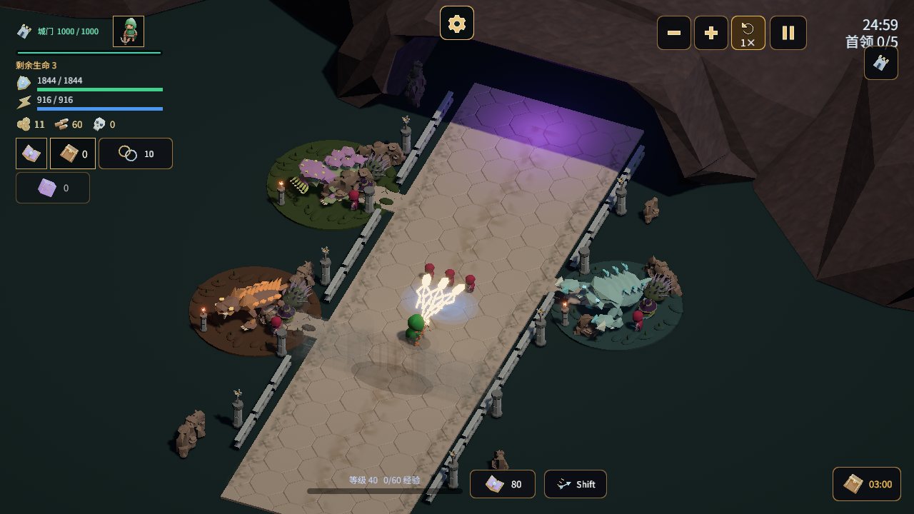
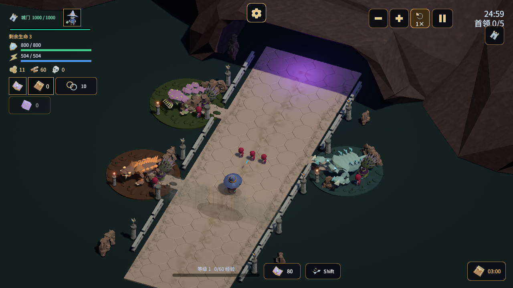
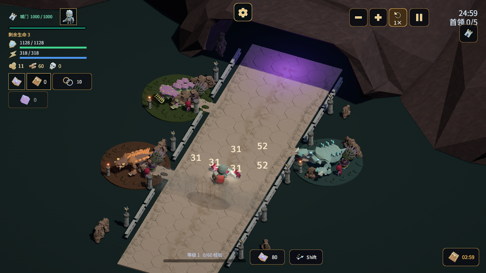
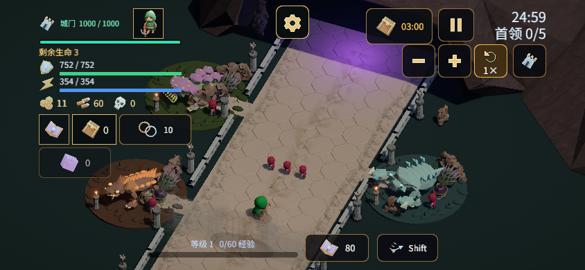
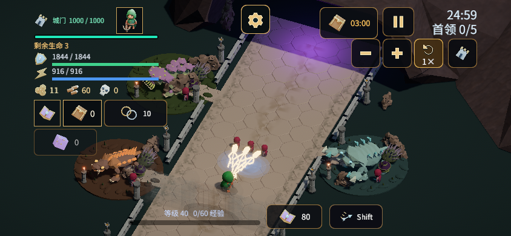
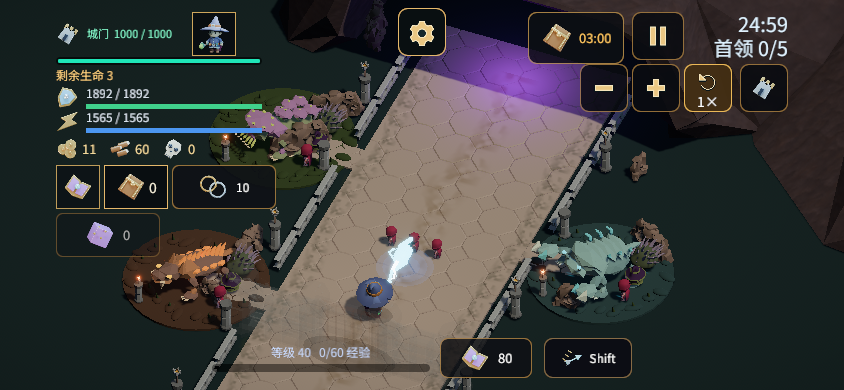
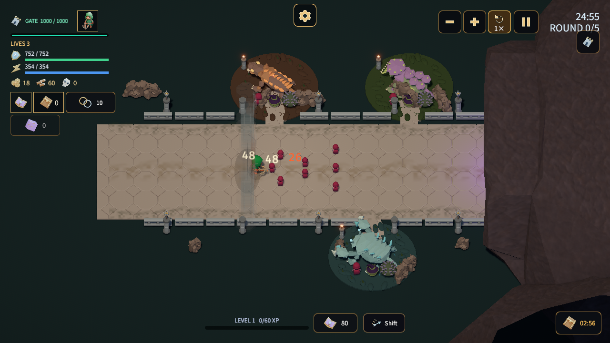

# Basic attack visual progression — 2026-11-15

Actual production attack captures with learned skills and ultimates suppressed. No damage, attack speed, collision radius, release timing, pierce, ricochet or passive stack mechanics changed.

## Changes

- Levels 1–9: solid wood arrows / narrow bolts / compact spell silhouettes; zero emissive; no trailing particles or ground light projection. Melee uses one clean slash with the existing class-specific motion.
- Levels 10–19: restrained single short trail and low emission; still simple projectile geometry and a single melee stroke.
- Levels 20–39: original authored advanced geometry and stronger effects unlock.
- Level 40+: original brightest multi-layer effects retained.
- Ember attack-speed passive only signals a new full-stack crossing at level 10+, instead of creating an orange pulse on every attack. Stack count and attack-speed values are unchanged.

## Verification

Ten 240-frame production captures passed flight, actual damage and tier-material assertions: archer/mage/sword at level 1 and 40 at 1280×720; archer/mage at level 1 and 40 at 844×390. Initial archer volley has exactly one arrow; advanced volley has three arrows targeting distinct enemies. Starter material peak emission is zero. See [capture results](capture-results.txt).

Representative images were visually inspected at full size. Archer flight is frame 17; mage flight frame 24; sword swing frame 30. The extra flight-image runs are 40-frame captures only; their longer 240-frame counterpart runs supply the gameplay assertions. Smaller screenshots verify viewport framing and effects, not a physical mobile device or touch input.

| Class / viewport | Level 1 | Level 40 |
| --- | --- | --- |
| Archer desktop |  |  |
| Mage desktop |  |  |
| Sword desktop |  |  |
| Archer narrow viewport |  |  |
| Mage narrow viewport |  |  |

Targeted unit coverage includes every ranged weapon switching geometry at level 20; plain vertex-colored arrow art; distinct per-tier materials; every melee class fading and cleaning up its real spawned trails without modifying projectile materials; Ember feedback only at a new full-stack crossing. Full library testing/build is coordinated by the parent task and its logs are under `target/attack-restraint/`.

## Reproduction

```sh
ROGUE_CAPTURE_SAVE_FRAMES=17,24,30,239 target/market-visual/debug/capture frames OUTPUT 240 weapon-growth-archer-starter 42 1280x720
```

Replace class with `mage` / `sword`, tier with `upgraded`, and viewport with `844x390` as needed. Raw output: `target/attack-restraint/weapon-*`.

## Learned fire proc and burning status

Ember Arrow ranks 1–2 now use a compact ember and brief contact spark, without
long beams, ground glow, impact pillars or layered travelling bursts. Ranks 3–5
restore richer effects. Persistent burning is a sparse small flame marker instead
of repeatedly spawning full bursts; strong spell casts retain their own spectacle.
Damage, burn timing, collision, velocity and lifetime remain unchanged.

Both rank 1 and rank 5 ran 305-frame production captures with real damage and
attributable skill geometry. The final rank-1 effect peaks at 2 named parts and
0.22 maximum visual scale; rank 5 retains the larger authored effect.
The controlled skill-camera scene is for effect inspection, not mobile layout QA.

| Rank 1 | Rank 5 |
| --- | --- |
|  |  |

## Regression results

Full library run: 833 passed, 1 failed, 1 ignored. The single failure was the old
level-10 ground-glow expectation in the single-target archer test. Updated to the
new level-20 policy and rerun: 1 passed, 0 failed. Its single-arrow, damage and
ricochet assertions remain intact. All 5 skill-feedback tests also passed,
including the new low-rank Ember combat-invariance check.

The final cosmetic status revision was rebuilt and rendered with real rank-1 and
rank-5 skill gameplay. Raw logs are in `target/attack-restraint/`.
