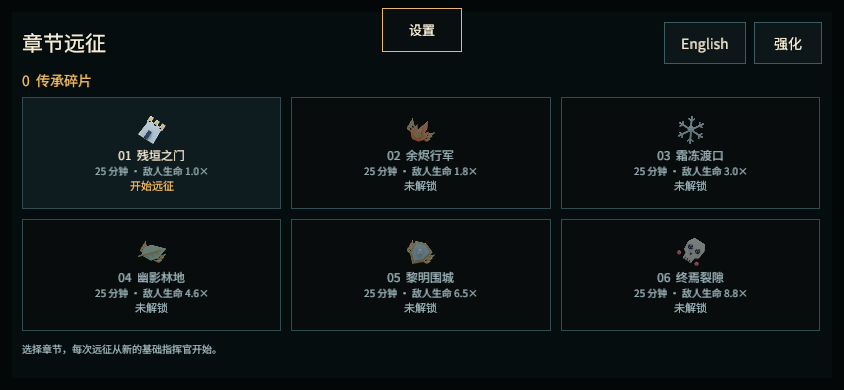
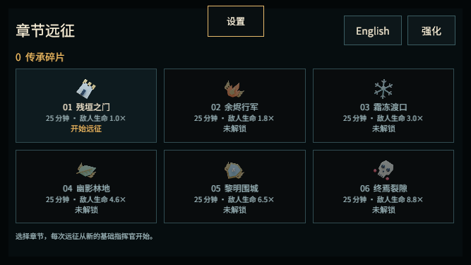
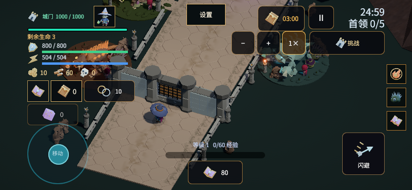
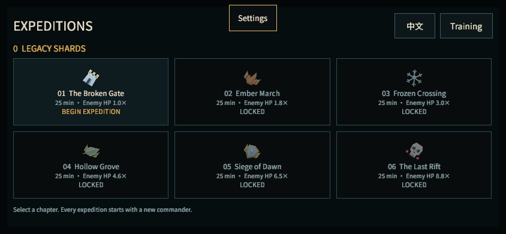

# Mobile landscape framing

Runtime revision: `37371c2`.

- Chapter cards reserve space for header, currency and footer before splitting remaining height into rows. Icons shrink with cards; exceptionally short windows retain scrolling.
- Compact/wide landscape battle projection spans 19 world units vertically instead of 28: approximately 47% larger characters. Standard 1280×720 desktop framing stays unchanged. Wide touch framing reserves the fixed footer before following the hero.

## Render evidence

Production capture renderer, Chinese, 1280×589, 844×390, 667×375 and 1280×720:

- All six chapter card bounds remain inside the actual computed scroll-body bounds.
- Camera framing scenario renders the starting position plus four controlled legal corner positions. All hero centers remain on screen; mobile captures inspected for control overlap. This is a controlled framing test, not a complete playthrough.
- English 844×390 chapter layout also inspected.

Raw logs: `target/mobile-framing-nov15/`. Reproduce with `capture still OUTPUT.png 22 campaign 42 844x390` and `ROGUE_CAPTURE_SAVE_FRAMES=10,59,119,179,239 capture frames OUTPUT_DIR 240 camera-framing-touch 42 844x390`.

Camera regression tests: **11 passed, 0 failed** (`cargo test --locked --lib arena::camera -- --test-threads=2`, cached verification profile). Covers resize, pause, respawn, shake preservation, no projection drift and touch-control exclusion.
