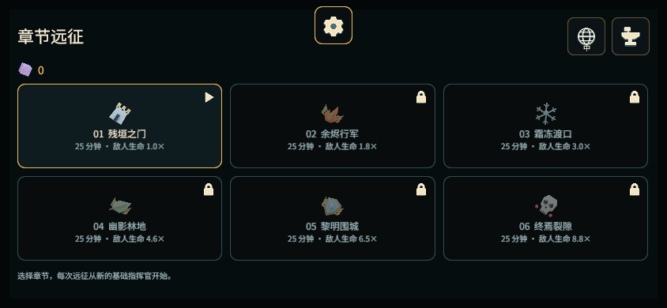
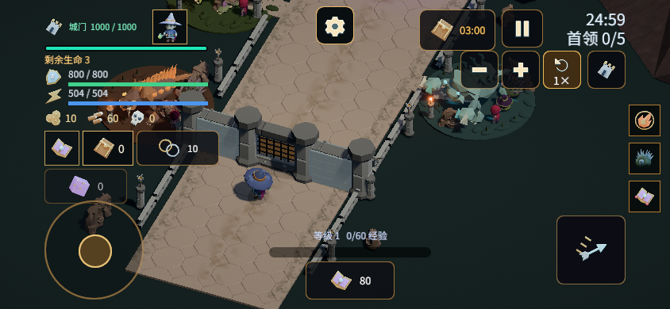
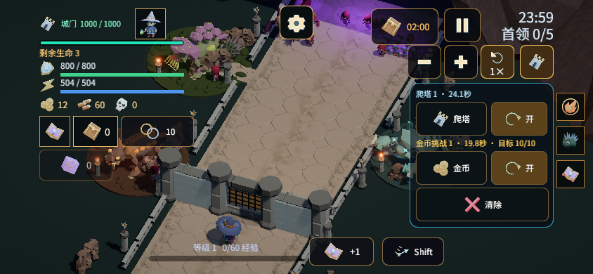
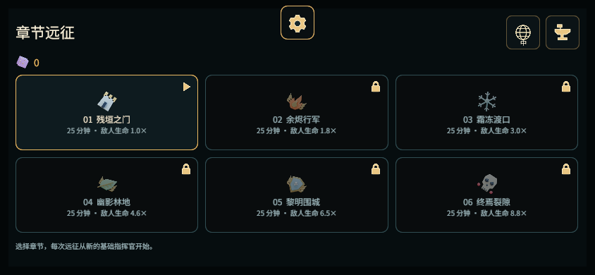
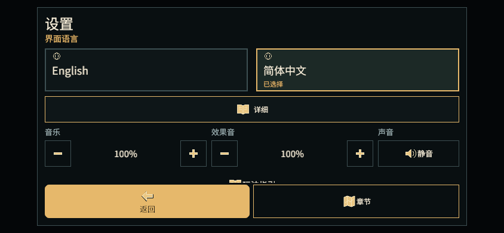
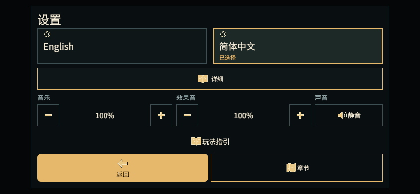

# Mobile icon controls

Release: `6d54f98` (UI code from `9814bc5`, corrected WebGL-compatible glyph textures).

- Authored 16 reusable control glyphs with editable SVG sources and reproducible PNG generation.
- Chapter tools use 48px icon targets; chapter states use play/lock/clear corner badges; portrait headings and tools no longer overlap.
- Settings uses a gear launcher, fixed header/footer and bounded, touch-scrolling content. Short labels remain where necessary for comprehension.
- Battle pause/speed/reset/challenge controls are icon-led, touch dodge displays art and cooldown, and the joystick appears only while held. Its touch region stays available while hidden.
- Detailed/simple selection uses a book glyph, short mode label and explanatory hint.

## Render checks

Production capture renderer at 844×390, 667×375, 390×844 and 1280×720. Chapter captures assert all six cards fit, heading/tools do not overlap and toolbar targets are at least 48px. Settings captures switch language, request scrolling past the bottom, verify the bounded position and visible audio controls, and preserve access to fixed navigation. Camera captures send actual TouchInput messages at the computed movement-pad center: frame 6 held, frame 10 released.

An initial settings scroll capture exposed a blank-body overscroll. The final captures below use the corrected content-bound clamping and strengthened assertions. Font coverage also caught two unsupported characters in new help copy; equivalent supported wording replaced them.

Raw logs/scripts: `target/mobile-icons-nov15/`. These are controlled production-renderer fixtures, not a complete campaign playthrough.

## Functional verification

- Full library suite: **829 passed, 0 failed, 1 ignored** (opt-in report only).
- Selection interaction through frame 124: real paid draft, detailed/simple/detailed toggles, unchanged skill rank and offers.
- Settings navigation: cancel departures without modifying the run, confirm return to chapters, reopen settings above chapters; visible controls retain minimum touch sizes.
- Trial drawer: tower/gold auto toggles, automatic trial entry, and cancel-all state transitions passed.

Validation notes: the optional selection fixture's later tidal-area hover assertion fails on the pre-change capture binary as well; it is not used as evidence for this UI change. The settings navigation audit now excludes explicitly `Display::None` controls (the fixture omits the onboarding plugin), while continuing to require at least five real, visible navigation controls and their bounds.

## Web texture compatibility

The initial live WebGL check caught 16-bit glyph PNGs, which native rendering supported but WebGL rejected (`Rgba16Unorm`, missing `TEXTURE_FORMAT_16BIT_NORM`). All 16 controls were regenerated as explicit PNG32 / 8-bit RGBA. The generator now enforces this format, and `verify_ui_assets.py` validates every control glyph's size, bit depth, color type, checksum and decompressed payload. A negative check rejected the original files; the corrected files pass. Browser verification must use the corrected asset release, not the initial runtime revision alone.

## Public browser verification

Pages run `43671770843` succeeded. Live `build.json` matches `6d54f98eea143571c9a3bd56ef0c34ad3a9deacd`; the served settings icon is 8-bit RGBA. A fresh browser at 844×390 rendered the chapter toolbar, clicked the gear to open settings, then returned to chapters. Page errors were empty and console output contained no render validation errors. This is actual browser mouse interaction at a mobile viewport; touch held/released evidence above comes from real TouchInput messages in the native harness, not a physical phone test.

A second actual browser check scrolled down 300px with the pointer inside the settings content area. The book icon and full tutorial action became visible, the fixed back button remained accessible, and clicking it returned to chapters. No browser or render errors occurred.

