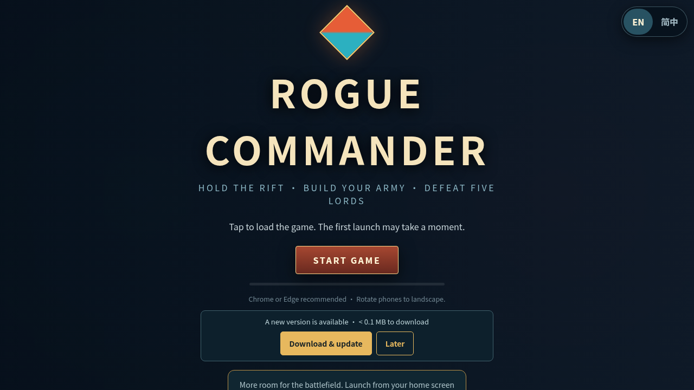
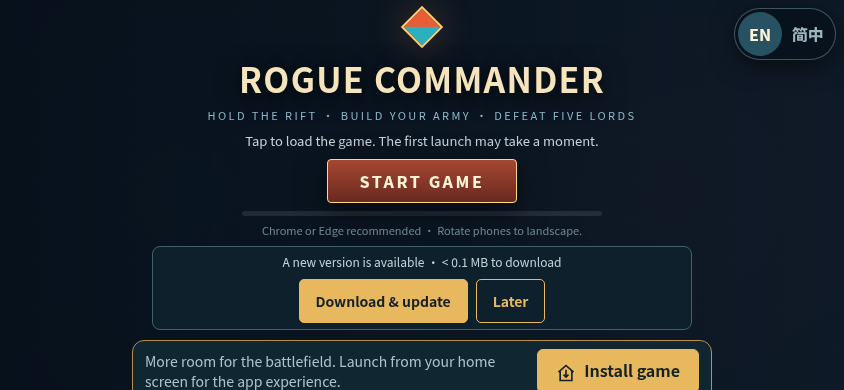
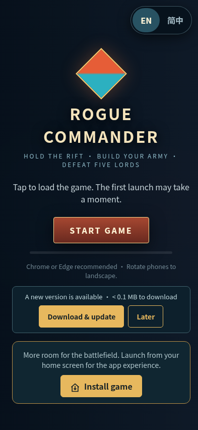

# Persistent cache and update browser verification

These tests use Chromium 156 and a real HTTP server, Service Worker lifecycle,
CacheStorage and MessageChannel. Browser HTTP cache is disabled by `no-store`
response headers. No storage/fetch/SW mocks are used. Assets are small fixtures,
so these results complement rather than replace the actual game offline test.

## Resource-cache integration: 10 passed

[Machine-readable results](cache-test-results.json). Test source:
[`tools/test_pwa_cache.cjs`](../../../tools/test_pwa_cache.cjs).

- Concurrent first preparation deduplicates identical content hashes and downloads
  the gzip engine only.
- Re-entry sends zero shell/model/texture/engine requests to the server.
- Closing the browser process, restarting and navigating while already offline
  loads the saved shell and resources.
- Detecting and deferring an update does not download game assets.
- Deferring, closing every tab/browser and reopening does not silently commit the
  waiting worker's candidate version when the browser naturally activates it.
- Accepting downloads exactly the changed content hashes; a still-open old tab
  retains its original version, including after `ServiceWorker.stopAllWorkers`.
- Same-length corrupted bytes fail SHA-256 verification and cannot activate.
- Retrying the damaged update succeeds without discarding the old complete game.
- A 503-interrupted update leaves the current game usable offline.
- Raw-WASM capability selection downloads only raw WASM and retains offline use.

## Production startup UI: 8 passed

[Machine-readable results](ui-test-results.json). Test source:
[`tools/test_pwa_update_ui.cjs`](../../../tools/test_pwa_update_ui.cjs).

Uses the actual `web/index.html`, `pwa.js`, `game-cache.js`, styles, icons, font and
service worker. Only the Bevy engine module is stubbed. The test clicks real UI
buttons and records which engine revision would initialize.

- Start prepares resources before initializing the engine.
- A second Start uses saved resources with zero asset network requests.
- Start, Update and Later fit all three tested viewports.
- Later starts the old engine.
- After closing the browser and natural worker activation, the next launch still
  offers the unaccepted update.
- Download & update commits/reloads and initializes the new engine.
- Failed update shows Retry while Start still launches the previous engine.
- An installed legacy network-only worker migrates via the waiting worker, then
  resumes Start after exactly one document reload. A second legacy-controlled
  tab is held open to ensure this exercises the waiting-worker path.

Screenshots were visually inspected. These are viewport tests, not physical
Android installation tests. The install panel remains scrollable on short screens.

| Desktop | Landscape phone | Portrait |
| --- | --- | --- |
|  |  |  |

[Failed update with previous version available](failed-update-old-version-available.png).

## Reproduce

Install the `playwright` Node module and a Chromium browser, then run:

```sh
node tools/test_pwa_cache.cjs
node tools/test_pwa_update_ui.cjs
```

For a separately installed browser, set `CHROMIUM_EXECUTABLE_PATH`. For a shared
Node dependency directory, set `NODE_PATH`. Results default to
`target/pwa-cache-tests/` and `target/pwa-update-ui-tests/`.
